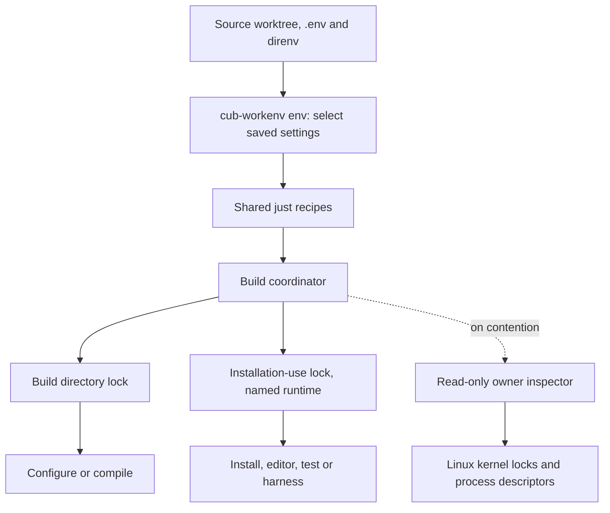
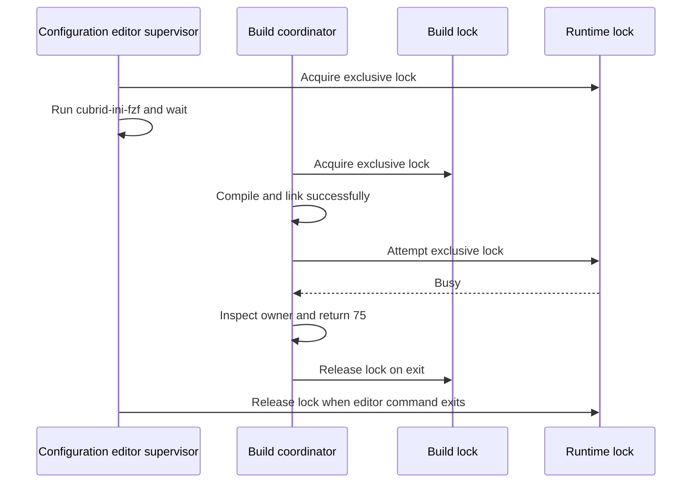
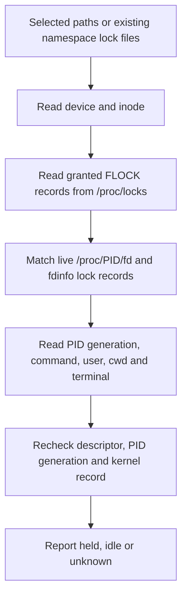

# CUBRID build and runtime locks

The coordinator separates compilation from installation. Compilation changes a
build directory. Installation replaces files that commands and tests can still
use. Each operation needs a different lock.

When compilation finishes but installation returns **75**, the compiled output
remains available. The installation guard detected a lock conflict or an active
executable under the installation prefix. After the environment becomes idle,
`just install` completes the remaining step.

This guide describes personal tooling in `my-cubrid`, inspected on 2026-10-20.
The implementation starts from revision `332d062` and adds live owner reporting.
These commands are local development tools. They are separate from CUBRID's
transaction locks, page latches, and native database file locks.

## Find the owner

Run these commands from a prepared CUBRID source worktree:

```sh
just locks
just locks-all
just locks-json
```

| Command | Scope |
| --- | --- |
| `just locks` | The selected build directory and installation |
| `just locks-all` | Held locks in the current user's coordinator namespace |
| `just locks-json` | The selected locks and owners as JSON |

The status commands do not acquire locks, create lock files, run CUBRID, or stop
processes. Host database initialization is unnecessary. `locks-all` also works
without a selected build or installation.

A busy command automatically prints the relevant owner report. For example:

```text
Installation deferred: the target CUBRID environment is busy.
Environment: /home/vimkim/.cub/install/develop/debug_gcc
The runtime lock could not be acquired.
Runtime lock: held
  Resource: /home/vimkim/.cub/install/develop/debug_gcc
  Lock file: /run/user/1000/cubrid-dev-locks-1000/runtime-<hash>.lock
  Holder: PID 1166036, user vimkim, FD [11]
    Process age: 2:28:21, started <UTC timestamp>
    Working directory: /home/vimkim/gh/cb/develop
    Terminal: /dev/pts/7
    Command: bash .../cubrid-build-coordinator.sh runtime 300 --database testdb -- cubrid-ini-fzf --database testdb --section common
No process was stopped. Retry with: just install
```

This is an illustrative report based on the configuration-editor incident.
The descriptor, terminal, and timestamp are example values. The process age
measures time since process creation. It does **not** measure lock duration.

The reported holder owns the locked descriptor. Its command often identifies
the editor, debugger, test runner, or container harness that caused contention.
Use the terminal and working directory to find that session. Finish or exit
that command normally, then retry installation.

## Components and responsibilities



The [shared recipes](../stow/cubrid/justfile) provide commands such as `build`,
`install`, `ctest`, and `db::ini`.
The [coordinator](../bin/cubrid-build-coordinator.sh) controls lock acquisition,
installation checks, command supervision, and exit status.
The [owner inspector](../bin/cubrid-lock-status.py) reads Linux process evidence.
Lock files remain the synchronization objects. Owner reports require no sidecar file.

`cub-workenv` owns host initialization, saved resource allocations, database
registration, and environment selection. It is a separate program.
The coordinator's `runtime` action asks it to load and check the selected
environment. The `installation-use` action only reserves use of the installation.
See [host work environments](host-workenv.md) and
[ADR-0002](adr/0002-workenv-authority.md) for that division.

## Lock identity and scope

The [.envrc loader](../stow/cubrid/.envrc) selects these paths by default:

```text
PRESET_MODE       = debug_gcc
CUBRID_BUILD_DIR  = <source worktree>/build_preset_debug_gcc
CUBRID            = $HOME/.cub/install/<worktree basename>/debug_gcc
```

`CUB_WORKENV_INSTALL` can select a dedicated installation prefix. Worktrees with
the same basename need different prefixes when they represent separate environments.

The coordinator canonicalizes each path with `realpath -m`. It hashes the path
bytes with SHA-256, without a trailing newline. The namespace is:

```text
${XDG_RUNTIME_DIR:-/tmp}/cubrid-dev-locks-${UID}/
    build-<hash of canonical CUBRID_BUILD_DIR>.lock
    runtime-<hash of canonical CUBRID>.lock
```

Consequently, two commands with the same canonical installation path compete for
the same runtime lock. Different canonical installation paths use different
runtime locks. Database names do not participate in runtime lock identity.
All coordinator locks use exclusive `flock` locking.

The namespace also depends on the user and `XDG_RUNTIME_DIR`. Commands in
different namespaces do not coordinate through these files. `locks-all` reports
the current namespace, rather than every environment on the host.

## What each operation locks

| Operation | Build lock | Runtime lock | Additional condition |
| --- | --- | --- | --- |
| `just configure` | During CMake configuration | None | Valid build selection |
| `just compile` | During compilation | None | Valid build selection |
| `just build` | During compilation and installation | After compilation, through installation | No executable active under the installation prefix |
| `just install` | During installation | During installation | No executable active under the installation prefix |
| `just ctest` | None | During the ctest command | No host DB initialization requirement |
| `runtime -- command` | None | During validation and the foreground command | Selected host environment ready |
| `installation-use -- command` | None | During the foreground command | No host DB initialization requirement |
| Arbitrary CMake `target` action | During the target | During the target | Conservative installation guard |
| `installation-delete` | During deletion | During deletion | Idle prefix and additional path/storage checks |
| `stop-and-build` | During compilation, stop, and installation | After compilation, through stop and installation | Valid selected environment and explicit stop request |

The table describes coordinator actions. Some recipe prerequisites run before
the coordinator, including JDK preparation and ctest socket checks.

Actions that need both locks acquire the **build lock first**. The ordinary
`build` action keeps that lock while it attempts to acquire the runtime lock.
An interactive editor can therefore block installation without blocking the
preceding compilation. A build waiting for installation also delays other
coordinated operations on that same build directory.

Runtime commands use one exclusive lock. Two coordinated tests against the same
installation serialize even when they select different database names.
The coordinator does not support recursive entry into the same runtime lock.

### Why the build returned 75



`just configure-build` runs configuration and then `build`. The `build` action
includes installation, so successful linking does not guarantee a successful
recipe exit. Configuration and build use separate coordinator invocations.

### Wait behavior

| Path | Default behavior |
| --- | --- |
| Build-directory acquisition | Wait up to 600 seconds, configurable with `CUBRID_BUILD_LOCK_TIMEOUT` |
| Installation in `build` or `install` | Attempt immediately, return 75 when busy |
| `just install-wait 300` | Retry the installation guard for up to 300 seconds |
| `just build-wait 300` | Compile first, then retry the installation guard for up to 300 seconds |
| Coordinator `runtime` or `installation-use` | Default wait 300 seconds, unless the caller supplies a timeout |

Installation retries check the runtime lock and native processes every two
seconds. Shared recipes often pass explicit timeouts, so their values override
the coordinator's `CUBRID_RUNTIME_LOCK_TIMEOUT` default.

## The supervisor owns the descriptor

The coordinator opens a lock file and passes its descriptor to `flock`.
The lock stays associated with that open file description after `flock` exits.
The Bash supervisor retains its descriptor until the coordinated command ends.

The `run_locked` function closes lock descriptors in the child before executing
the requested command. Daemons started by that child do not inherit the locks.
The supervisor forwards TERM, INT, and HUP to its immediate child. It waits for
that child, including its signal cleanup, before returning its exit status.

An interactive command therefore keeps the lock for its entire session. The
configuration picker uses the same runtime action as other host operations.
It keeps the installation reserved while it waits for input.

Persistent managed containers need a longer lifetime. Their foreground harness
remains active after the test finishes. The lock remains held while the owned
container still exists, including after it stops running. The
[container helper](../bin/cubrid-podman-test.sh) tracks its invocation label and
container ID, then waits for removal or performs owned cleanup on a signal.
This protects a host installation that the container bind-mounts.

## How owner discovery works

The PID in `/proc/locks` can identify the exited `flock` utility. Reporting that
PID alone can miss the live supervisor. The inspector instead joins kernel
lock records to the descriptors that still own their open file descriptions.



The inspector uses device and inode identity rather than a filename match.
It requires a matching granted lock record in `fdinfo`. A process that merely
opens the same file does not qualify as a holder.

Process start ticks distinguish PID generations. The inspector checks them
again after it reads process details. It also checks the descriptor and kernel
record again. If the lock changes during inspection, the report says `unknown`
and requests another status query.

Each owner includes PID, UID/user, descriptor numbers, command arguments,
working directory, terminal when available, process start time, and process age.
The inspector redacts common credential flags and assignments in reported arguments.
The inspector reads only the selected installation/build values from process
environment data for resource attribution. It does not report that environment.

For `locks-all`, an owner's environment can recover the resource path behind
a hashed filename. The inspector reports it only when its hash matches the
lock filename. Otherwise, the resource remains unavailable.

### Output and limitations

| State | Meaning |
| --- | --- |
| `idle` | No granted coordinator flock appeared for that file in the observation |
| `held` | A granted flock appeared, with any accessible verified holders |
| `unknown` | The evidence changed or could not establish the lock state |

A held lock can have no accessible owner. The report explains that visibility
or ownership prevented attribution. Status is an observation, not a reservation
or an atomic snapshot of all processes. Permissions, namespaces, and process
exit limit the available evidence.

The JSON root contains `schema_version: 1`, `namespace`, and `locks`.
Each lock contains `kind`, `resource`, `path`, `state`, and `owners`, with a
`reason` when necessary. Selection or inspection failure can add a root `error`.
Status returns 0 for completed held/idle observations and 1 for unknown state
or inspection failure. Invalid arguments return 2. Busy operations retain
their exit status 75 even when owner inspection fails.

For all held locks as JSON, call the coordinator directly:

```sh
"${MY_CUBRID:-$HOME/my-cubrid}/bin/cubrid-build-coordinator.sh" locks --all --json
```

An existing `.lock` file alone does not establish ownership. Kernel lock state
and the live descriptor determine ownership. Removing the pathname can create
two separate synchronization objects, so it is not a way to release the lock.

## Other protection mechanisms

The coordinator also checks `/proc/PID/exe` before replacing or deleting an
installation. It rejects an executable whose path is under the canonical
installation prefix. This catches visible native processes that started
outside the coordinator, including daemons that correctly inherited no lock.
Such failures print the active native PIDs and executable paths.

This process scan cannot reserve against a direct launcher starting afterward.
It also does not establish the absence of processes with mapped installation libraries.
Ordinary `cubrid` and `csql` commands remain supported without a coordinator
wrapper. Native database exclusion remains CUBRID's responsibility.

| Mechanism | Purpose | Lifetime |
| --- | --- | --- |
| Coordinator build lock | Serialize coordinated work on a build directory | Coordinator invocation |
| Coordinator runtime lock | Reserve installation use and prevent coordinated replacement | Foreground command or persistent harness |
| `.cub-workenv/init.lock` | Serialize cooperating host preparation and database lifecycle helpers | Preparation/lifecycle operation |
| Workenv `allocations.lock` | Serialize allocation registry changes | Allocation transaction |
| Saved allocation record | Retain port, SHM, TMP, and selection assignments | Across stopped sessions |
| Native CUBRID file locks | Reject competing independent openers of physical database storage in supported native paths | Native opener |

The owner commands inspect the two coordinator lock classes. They do not
inventory workenv preparation locks or engine locks. Saved allocations are
records, rather than continuous operating-system reservations.

The inspected `cubrid-workenv` revision is `73ba1a89f9641690e7f72c99bdd2b44b8fe74332`.
Its `cubrid_workenv/state.py`, `allocation.py`, `database.py`, and `loading.py`
implement preparation, allocation transactions, creation, and cheap selection.
Use `just workenv::status` for saved settings. Use `just workenv::doctor` for
read-only host diagnosis. Build/install and ctest do not require explicit host
database initialization. Initialization remains a separate `cub-workenv init`
operation.

## Source and verification

| Source | Relevant behavior |
| --- | --- |
| [Coordinator](../bin/cubrid-build-coordinator.sh) | Lock keys, acquisition order, busy reports, native process checks, supervision |
| [Owner inspector](../bin/cubrid-lock-status.py) | Kernel/descriptor join, process generation checks, text and JSON reports |
| [Core recipes](../stow/cubrid/.just/core.just) | Explicit timeouts, build/install split, ctest reservation, lock commands |
| [Database recipes](../stow/cubrid/.just/db.just) | Configuration picker wrapped by `runtime` |
| [Environment loader](../stow/cubrid/.envrc) | Preset and installation selection |
| [Container helper](../bin/cubrid-podman-test.sh) | Persistent harness and owned container cleanup |
| [Owner tests](../tests/lock-status-test.py) | Actual contention, owner exit/replacement, unrelated opener, unknown state, credential redaction |
| [Coordinator tests](../tests/runtime-lock-test.py) | Serialization, descriptor inheritance, signals, readiness and busy installation |

Run the isolated tooling tests from the `my-cubrid` checkout:

```sh
python3 -B tests/lock-status-test.py
python3 -B tests/runtime-lock-test.py
```

These tests use temporary lock namespaces and fixture commands. They do not
compile CUBRID or operate on a user's databases. They establish coordinator
behavior, rather than database format compatibility or complete host isolation.
